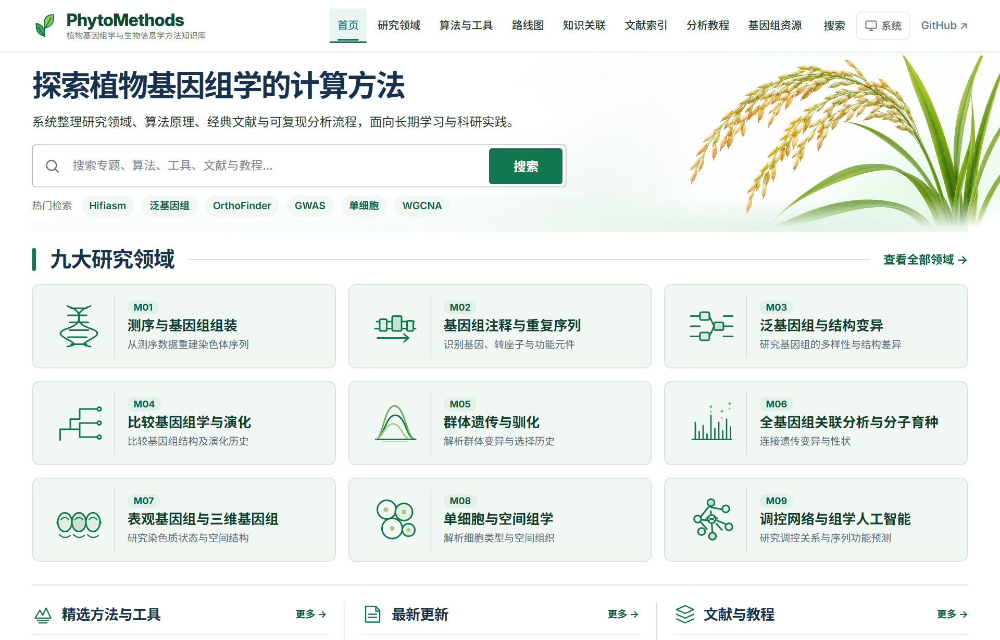
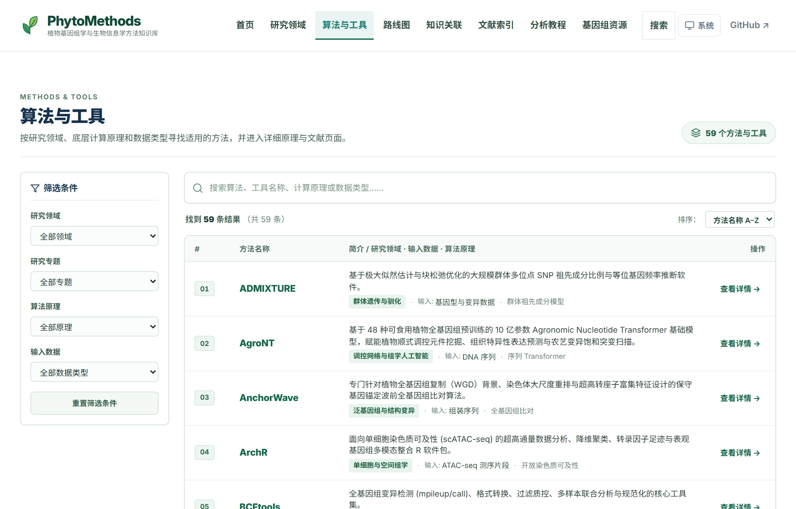
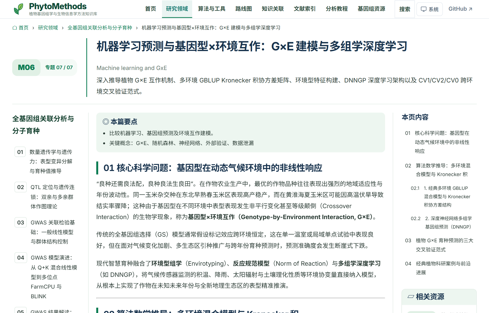
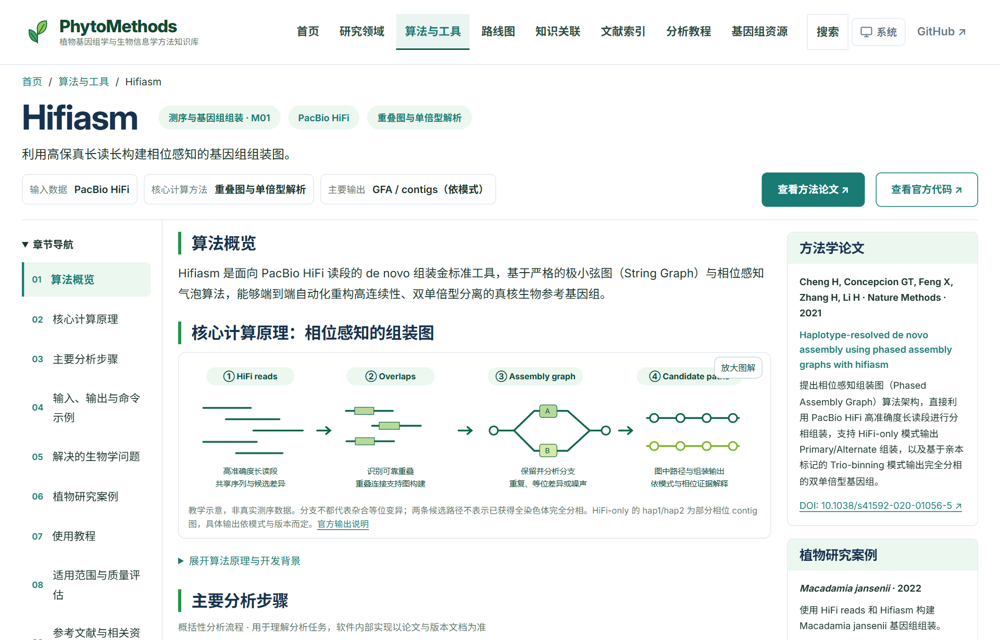
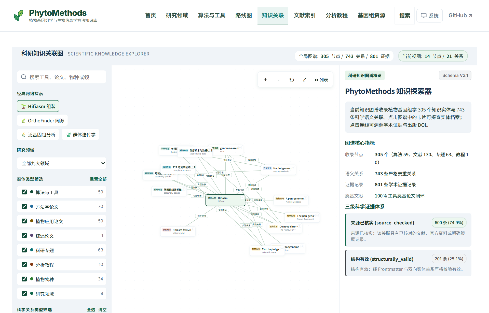
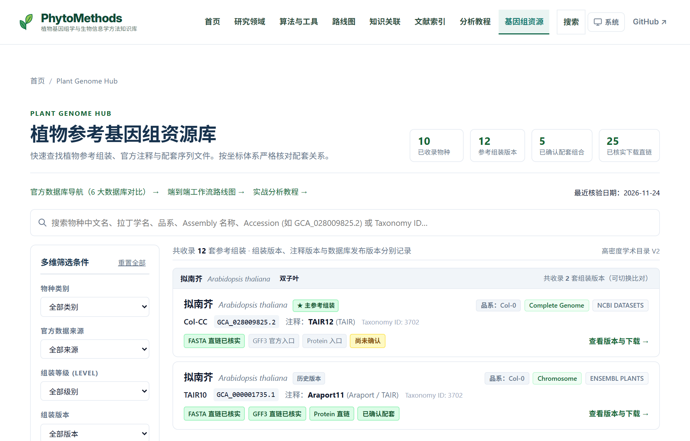
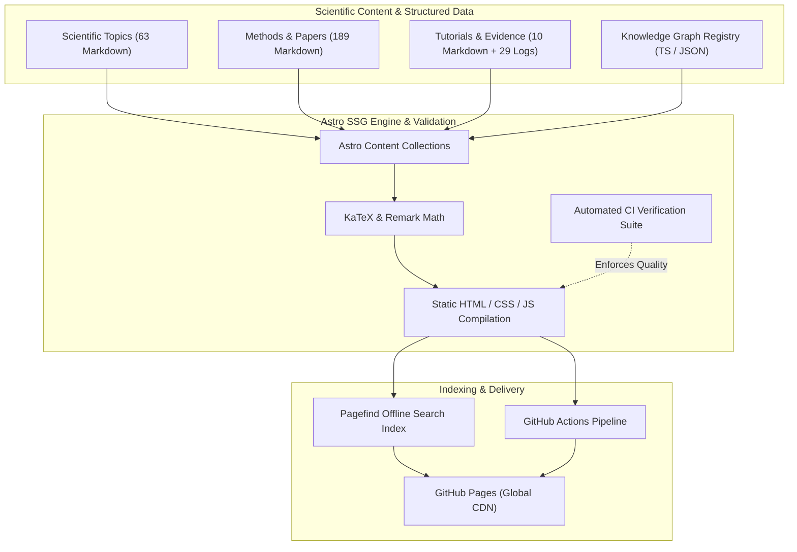

<p align="center">
  
</p>

<h3 align="center">A Scientific Knowledge Base for Plant Genomics and Bioinformatics</h3>

<p align="center">
  <strong>English</strong> | <a href="README.zh-CN.md">简体中文</a>
</p>

<p align="center">
  <a href="https://hao1006sy-source.github.io/phytomethods/"><strong>Explore Live Website &rarr;</strong></a>
</p>

<p align="center">
  <a href="https://github.com/hao1006sy-source/phytomethods/releases"></a>
  <a href="https://github.com/hao1006sy-source/phytomethods/actions/workflows/ci.yml"></a>
  <a href="https://github.com/hao1006sy-source/phytomethods/actions/workflows/deploy.yml"></a>
  <a href="https://astro.build"></a>
  
  
</p>

---

## Overview

**PhytoMethods** is a free, publicly accessible scientific knowledge base dedicated to plant genomics and bioinformatics. It integrates algorithmic principles, mathematical foundations, scientific literature, practical tutorials, and traceable research evidence to support researchers, graduate students, and computational biologists in understanding and applying computational methods across plant science.

The platform is developed as a long-term non-profit resource, providing transparent, reproducible, and structured knowledge across the entire continuum of modern plant genomics research.

---

## Project Scale

The data below is extracted directly from the verified database of **PhytoMethods V2.4 Stable** (Audit Date: November 25, 2026):

| Resource Category | Count | Scope & Coverage |
|:---|---:|:---|
| **Research Domains** | **9** | Covering sequencing assembly to single-cell and AI foundation models |
| **Scientific Topics** | **63** | Deep-dive articles with theoretical concepts and mathematical formulas |
| **Computational Methods** | **59** | Core bioinformatics algorithms, software profiles, and parameters |
| **Scientific Publications** | **130** | 70 method benchmark papers + 59 plant applications + 1 review paper |
| **Practical Tutorials** | **10** | Step-by-step reproducible workflows (8 verified, 2 template) |
| **Scientific Illustrations** | **27** | Handcrafted original SVG diagrams illustrating algorithms and models |
| **Method Comparison Matrices** | **9** | Structured decision matrices for algorithm selection across all domains |
| **End-to-End Workflows** | **3** | Complete research pipelines with multi-stage guidance |
| **Plant Genome Hub Species** | **10** | Major model and crop species with curated assemblies and annotations |
| **Knowledge Graph Nodes** | **305** | Domains, topics, methods, publications, species, and tutorials |
| **Knowledge Graph Relations** | **743** | Semantically verified relationships linking literature and algorithms |
| **Traceable Evidence Records** | **801** | 600 primary-source checked + 201 structurally validated citations |

---

## Nine Research Domains

PhytoMethods structures plant genomics into nine interconnected scientific domains:

| Domain ID | Research Domain | Key Representative Methods | Live Access |
|:---|:---|:---|:---:|
| **M01** | **Genome Sequencing & Assembly** | Hifiasm, Verkko, YaHS, Merqury, Minimap2 | [Explore M01 &rarr;](https://hao1006sy-source.github.io/phytomethods/topics/genome-assembly/) |
| **M02** | **Genome Annotation & Repetitive Elements** | EDTA, RepeatModeler2, BRAKER3, tRNAscan-SE, InterProScan | [Explore M02 &rarr;](https://hao1006sy-source.github.io/phytomethods/topics/genome-annotation/) |
| **M03** | **Pangenomics & Structural Variation** | Minigraph-Cactus, PGGB, SyRI, CuteSV, Sniffles2, vg | [Explore M03 &rarr;](https://hao1006sy-source.github.io/phytomethods/topics/pangenomics-structural-variation/) |
| **M04** | **Comparative Genomics & Evolution** | OrthoFinder, MCScanX, CAFE 5, IQ-TREE 2, wgd, PAML | [Explore M04 &rarr;](https://hao1006sy-source.github.io/phytomethods/topics/comparative-genomics/) |
| **M05** | **Population Genetics & Demographic History** | PLINK, BCFtools, ADMIXTURE, SMC++, PSMC, XP-CLR, selscan | [Explore M05 &rarr;](https://hao1006sy-source.github.io/phytomethods/topics/population-genetics/) |
| **M06** | **GWAS & Molecular Breeding** | GAPIT 3, FarmCPU, rrBLUP, R/qtl2, DNNGP | [Explore M06 &rarr;](https://hao1006sy-source.github.io/phytomethods/topics/gwas-breeding/) |
| **M07** | **Epigenomics & 3D Genomics** | Bismark, DSS, MACS3, HiCExplorer, MEME Suite, CUT&Tag | [Explore M07 &rarr;](https://hao1006sy-source.github.io/phytomethods/topics/epigenomics-3d-genome/) |
| **M08** | **Single-Cell & Spatial Omics** | Scanpy, Squidpy, CellRank 2, Cell2location, ArchR, DoubletFinder | [Explore M08 &rarr;](https://hao1006sy-source.github.io/phytomethods/topics/single-cell-spatial-omics/) |
| **M09** | **Gene Regulatory Networks & AI** | DESeq2, WGCNA, GENIE3, GRNBoost2, AgroNT, PlantCAD2 | [Explore M09 &rarr;](https://hao1006sy-source.github.io/phytomethods/topics/regulatory-genomics-ai/) |

---

## Core Features

### 1. Scientific Topics (63 Articles)
In-depth reviews exploring fundamental principles, mathematical formulations, biological contexts, and computational tradeoffs. Topics integrate inline and display KaTeX mathematics ($L_0/L_1/L_2$ regularizations, hidden Markov models, coalescent equations, negative binomial generalized linear models) with domain-specific plant examples.

### 2. Computational Methods (59 Profiles)
Comprehensive documentation of major algorithms in plant bioinformatics. Each profile details:
- Theoretical principles and algorithmic mechanisms.
- Input/output data formats (FASTA/FASTQ, GFA, VCF, BAM, AnnData, BED).
- Critical parameter semantics and tuning guidance.
- Verified software versions and official code repositories.
- Documented applications in major plant crop research.

### 3. Scientific Literature & Evidence (130 Papers)
A bidirectional literature hub indexing 70 foundational methodology papers and 59 landmark plant application studies (covering rice, maize, wheat, soybean, Arabidopsis, tomato, sorghum, etc.). Every record includes direct DOI links, PubMed accession numbers, key findings, and exact chapter/table citations in the primary literature.

### 4. Practical Analysis Tutorials (10 Modules)
Step-by-step reproducible tutorials providing actual code blocks, expected outcomes, and troubleshooting guides:
- **Verified Tutorials (8 modules)**: Bismark, CAFE 5, GWAS (OLS), OrthoFinder, PLINK, Scanpy, SyRI, and WGCNA. Fully executed against synthetic benchmarks or official test datasets, with 29 real execution logs, output tables, and checksums permanently archived under `examples/`.
- **Command Template Tutorials (2 modules)**: Hifiasm and EDTA. Formally labeled as `tested: template`, providing verified official command templates while transparently declaring that plant whole-genome runs require dedicated high-performance computing resources.

### 5. Scientific Knowledge Graph
An interactive network linking 305 research entities across 743 relationships. Powered by Cytoscape and SVG, users can traverse from a biological question (e.g., polyploid subgenome phasing) to corresponding algorithms (e.g., SubPhaser, AnchorWave), foundational papers, and tutorials.

### 6. Plant Genome Hub
A consolidated gateway providing verified genome assemblies, gene annotation releases, download mirrors, and primary database portals for 10 key plant species: *Arabidopsis thaliana*, *Oryza sativa* (Rice), *Zea mays* (Maize), *Triticum aestivum* (Wheat), *Glycine max* (Soybean), *Solanum lycopersicum* (Tomato), *Solanum tuberosum* (Potato), *Sorghum bicolor* (Sorghum), *Hordeum vulgare* (Barley), and *Populus trichocarpa* (Poplar).

### 7. Method Comparison Matrices
Nine domain-specific decision matrices comparing tools side-by-side on algorithm class, input requirements, memory and time complexities, biological strengths, limitations, and selection recommendations.

### 8. Search & Reading Experience
Integrated with client-side Pagefind full-text search supporting bilingual Chinese-English synonyms and gene/algorithm abbreviations. Fully responsive layout with mobile optimization and dark mode support.

---

## Scientific Principles & Evidence Standards

PhytoMethods adheres to strict scientific evidence standards:

- **Plant-Oriented Relevance**: Emphasizes polyploidy, high heterozygosity, large repetitive transposable element fractions, and epigenetic contexts unique to plant genomes.
- **Mathematical & Algorithmic Rigor**: Prioritizes underlying statistical models over black-box execution recipes.
- **Traceable Primary Literature**: Every claim is linked to published peer-reviewed papers with exact DOIs and section locators.
- **Version-Aware Transparency**: Discloses exact software releases and differentiates major architectural updates (e.g., Hifiasm 2021 HiFi-only vs. 2022 Hi-C; MSMC v1.1.0 vs. MSMC2).
- **Honest Evidence Boundaries**: Explicitly distinguishes executed test results from unverified command templates. Claims of "complete verification" are strictly prohibited unless backed by physical execution logs.

---

## Screenshots

<div align="center">
  <table>
    <tr>
      <td width="50%">
        
        <p align="center"><em>Homepage Overview with Curation & Navigation</em></p>
      </td>
      <td width="50%">
        
        <p align="center"><em>Methods Directory with Multi-faceted Filtering</em></p>
      </td>
    </tr>
    <tr>
      <td width="50%">
        
        <p align="center"><em>Scientific Topics with KaTeX & Original Diagrams</em></p>
      </td>
      <td width="50%">
        
        <p align="center"><em>Method Detail with Algorithmic Principles & Benchmarks</em></p>
      </td>
    </tr>
    <tr>
      <td width="50%">
        
        <p align="center"><em>Interactive Scientific Knowledge Graph Explorer</em></p>
      </td>
      <td width="50%">
        
        <p align="center"><em>Plant Genome Hub: Curated Datasets & Portals</em></p>
      </td>
    </tr>
  </table>
</div>

---

## Technical Architecture

PhytoMethods is built with a modern static-site generation (SSG) pipeline designed for fast load times, zero-cost public hosting, full accessibility, and complete content-presentation separation:



- **Framework**: [Astro v5](https://astro.build/) (Content Collections, Server-Islands / Static Generation)
- **Language**: TypeScript & Modern JavaScript (ESM)
- **Content Format**: Extended CommonMark Markdown with YAML frontmatter
- **Typography & Math**: [KaTeX](https://katex.org/) for fast LaTeX mathematical rendering
- **Search Engine**: [Pagefind](https://pagefind.app/) for multi-lingual, zero-backend static indexing
- **Quality Assurance**: Python 3 link checker, custom AST parsers, and [Playwright](https://playwright.dev/) browser tests
- **Deployment**: Automated CI/CD via GitHub Actions and GitHub Pages

---

## Repository Structure

```text
phytomethods/
├── .github/workflows/          # GitHub Actions CI & Pages deployment workflows
├── docs/                       # Project documentation, guidelines, and audit reports
│   └── assets/readme/          # Verified screenshots and preview assets
├── examples/                   # Primary execution logs, synthetic datasets, and outputs
│   ├── cafe5/                  # CAFE 5 dual-model execution logs
│   ├── coexpression/           # WGCNA synthetic co-expression network results
│   ├── gwas/                   # GWAS single-marker OLS verification outputs
│   ├── methylation/            # Bismark bisulfite alignment and CX extraction logs
│   ├── orthofinder/            # OrthoFinder benchmark statistics and species trees
│   ├── population/             # PLINK PCA eigenvalues and allele frequencies
│   ├── single-cell/            # Scanpy UMI matrices and Leiden clustering results
│   └── syri/                   # SyRI structural variation summary tables
├── public/                     # Static web assets (logos, illustrations, icons)
│   ├── brand/                  # Vector logos and brand graphics
│   └── images/topics/          # 27 handcrafted SVG scientific diagrams
├── scripts/                    # Comprehensive validation and auditing test suites
├── src/                        # Main website source code
│   ├── components/             # Reusable Astro UI components
│   ├── content/                # Content collections (topics, methods, papers, tutorials)
│   ├── data/                   # Structured metadata, comparison matrices, and genomes
│   ├── layouts/                # Base layout, navbar, footer, and styling
│   ├── lib/knowledge/          # Knowledge graph builder, types, and evidence registries
│   └── pages/                  # Static routes and dynamic collection endpoints
├── outputs/                    # Built search indexes and knowledge graph audit artifacts
└── astro.config.mjs            # Astro configuration with site and base routing
```

---

## Local Development

### Prerequisites
- **Node.js**: `v20.x` or `v24.x` (LTS recommended)
- **npm**: `v10.x` or later
- **Python**: `3.9+` (required for link checking and verification scripts)

### Setup & Run

1. **Clone the repository**:
   ```bash
   git clone https://github.com/hao1006sy-source/phytomethods.git
   cd phytomethods
   ```

2. **Install dependencies**:
   ```bash
   npm ci
   ```

3. **Start local development server**:
   ```bash
   npm run dev
   ```
   *The site will be available at `http://localhost:4321/phytomethods/`.*

4. **Production Build & Search Indexing**:
   ```bash
   npm run build
   ```

5. **Preview Production Build**:
   ```bash
   npm run preview
   ```

---

## Quality Assurance & Automated Testing

PhytoMethods maintains an exhaustive automated verification pipeline to prevent regressions and maintain scientific accuracy:

```bash
# Execute the complete local validation suite
npm run validate
```

The test runner sequentially enforces **13 strict quality gates**:
1. `astro check`: Strict TypeScript type and component prop validation.
2. `astro build`: Static rendering of all 293 web pages.
3. `pagefind`: Comprehensive client-side search index generation.
4. `check-home-curation.mjs`: Homepage domain and curated card integrity.
5. `check-domain-v2.mjs`: Complete structural validation of M01–M09 domain configurations.
6. `check-links.py`: Zero dead-link verification across 13,160+ internal anchors and URLs.
7. `audit:knowledge`: Bidirectional connectivity and integrity of all graph nodes and edges.
8. `test:knowledge-integrity`: Dynamic mathematical equivalence assertions for all evidence entries.
9. `test:application-evidence`: Primary literature citation audit for 56 application method edges.
10. `test:msmc-chronology`: Strict chronological and methodological decoupling of MSMC vs. MSMC2.
11. `test:independent-evidence`: End-to-end evidence penetration review across 67 key relations.
12. `check:topic-markdown`: Markdown parsing and zero raw-tag boundary leakage check.
13. `check:scientific-taxonomy`: Comprehensive taxonomy and primary-source justification verification.

---

## Version History & Milestones

| Version | Status | Key Milestones |
|:---|:---:|:---|
| **V1.0 – V1.3** | Completed | Initial architecture, Astro SSG migration, core UI layout, and initial content structure. |
| **V2.0 – V2.2** | Completed | Scientific classification reform, calculation resource profiles, and evidence auditing registry. |
| **V2.3** | Completed | Systematic expansion of 63 scientific topics, KaTeX formulations, and 27 original SVG diagrams. |
| **V2.4** | **Stable** | Comprehensive methodology and literature refinement (130 papers), tutorial reproducibility overhauls (10 modules), evidence decoupling, and entering maintenance mode. |

### V2.4 Milestone Metrics (Actual File Modifications)
- **42** Computational Method profiles updated with verified specifications.
- **125** Scientific Publication entries refined with primary literature evidence.
- **8** Practical Tutorials enhanced with execution data and contingency matrices.
- **5** Scientific Topic overhauls and **3** SVG diagrams refined.
- Dynamic knowledge graph audit system successfully decoupled from rigid hardcoded thresholds.

---

## Citation & Feedback

### Citing Scientific Literature
When utilizing specific algorithms, mathematical models, or benchmark datasets in your research, **please cite the original peer-reviewed publication** authored by the algorithm's creators. PhytoMethods provides direct DOI and PubMed links in every method and literature page to facilitate appropriate academic attribution.

### Citing PhytoMethods
If PhytoMethods assisted your computational research, academic education, or methodology survey, you may cite this knowledge base as:

```bibtex
@misc{phytomethods2026,
  title        = {PhytoMethods: A Scientific Knowledge Base for Plant Genomics and Bioinformatics},
  author       = {{PhytoMethods Contributors}},
  year         = {2026},
  howpublished = {\url{https://hao1006sy-source.github.io/phytomethods/}},
  note         = {Version 2.4 Stable, accessed [Your Access Date]}
}
```

### Community Feedback & Contributions
We welcome scientific suggestions and bug reports from the research community. Please submit feedback via [GitHub Issues](https://github.com/hao1006sy-source/phytomethods/issues) regarding:
- Factual inaccuracies or outdated algorithmic models.
- Literature citation discrepancies or broken DOI locators.
- Mathematical notation typos or LaTeX rendering glitches.
- Newer official software releases or major parameter changes.
- Broken links or data mirror updates.

For contribution standards, please refer to [docs/content-guide.md](docs/content-guide.md).

---

## Non-Profit Terms & Maintenance Status

PhytoMethods is an open-access, non-profit academic resource created for scientific research and education. Third-party algorithm names, trademarks, database logos, and paper excerpts belong to their respective original authors and academic publishers.

**Project Status**: **V2.4 Stable — Maintenance Mode**  
*PhytoMethods is currently in its stable maintenance phase. Future updates focus on scientific accuracy, literature verification, software documentation updates, and long-term web accessibility.*
