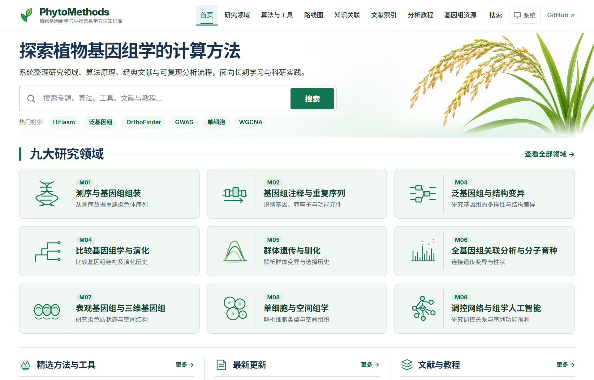
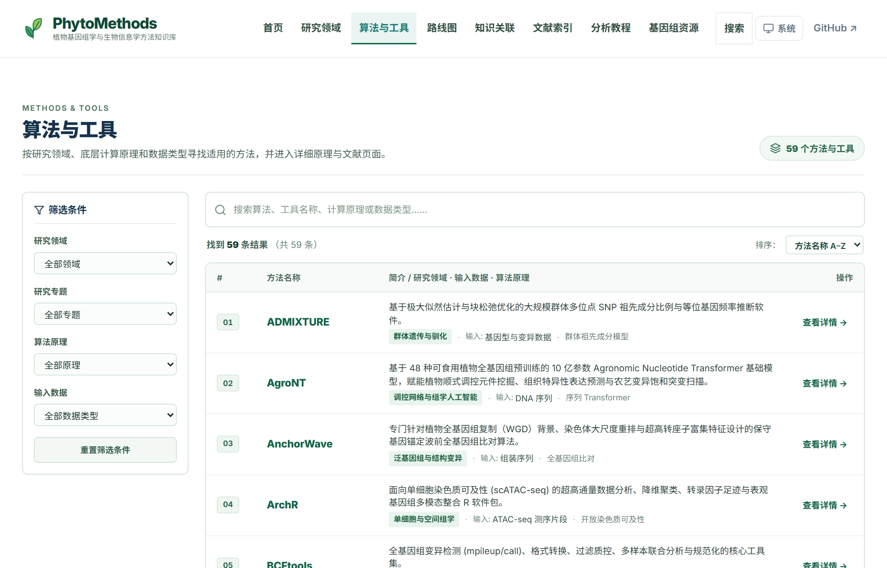
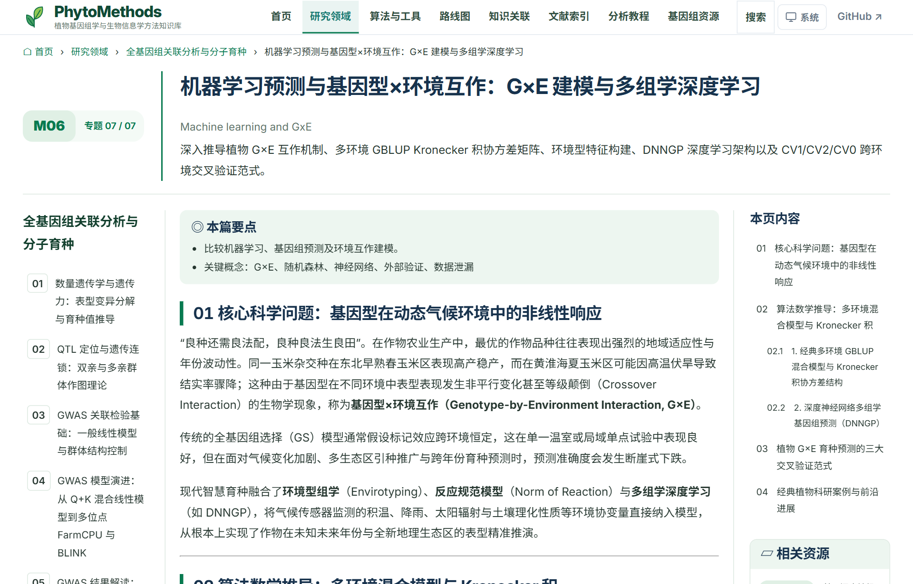
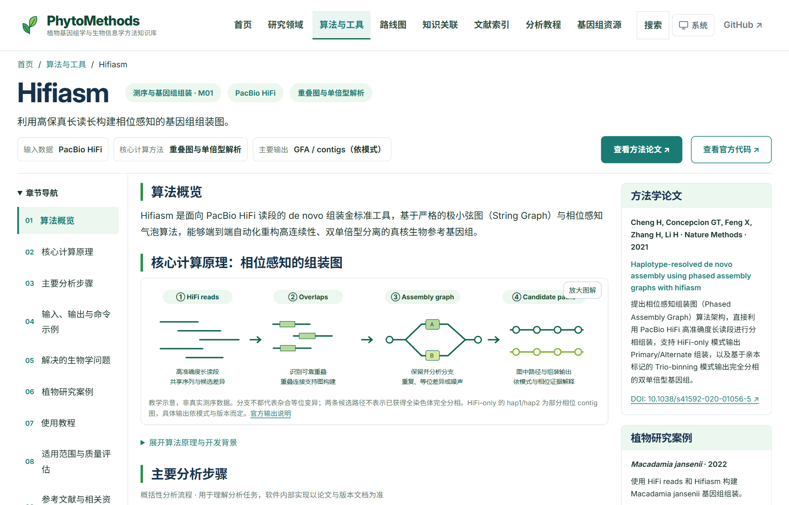
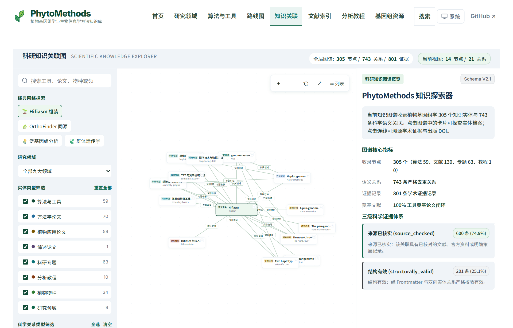
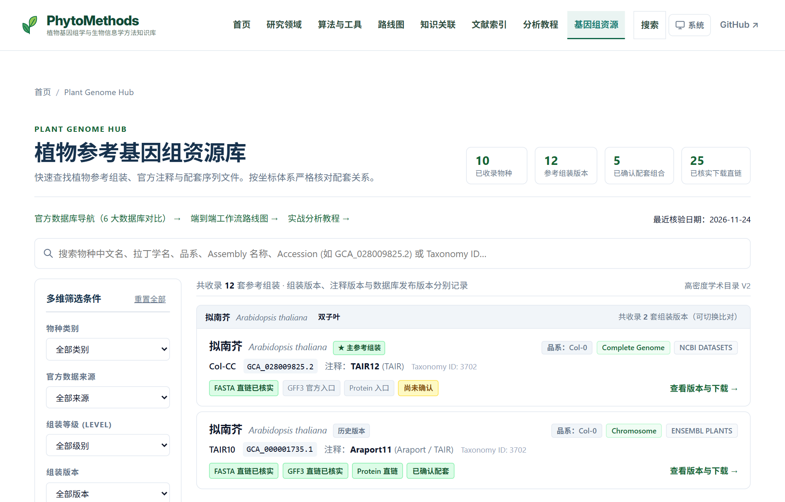
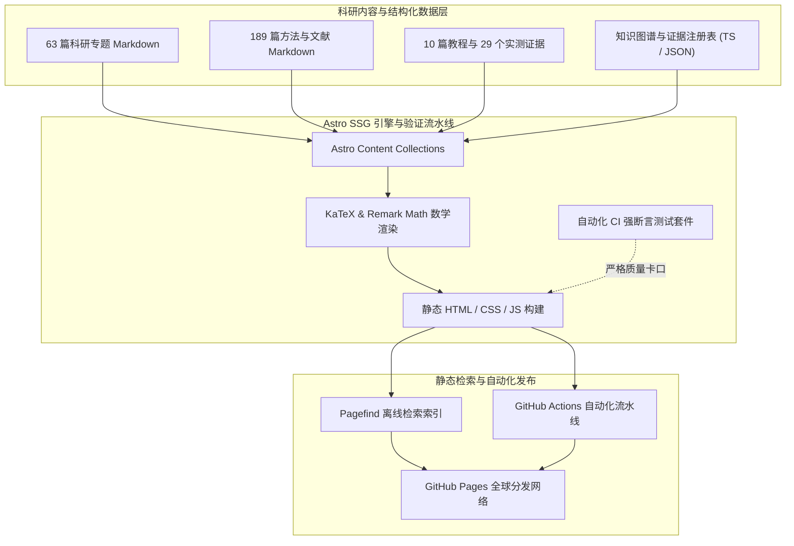

<p align="center">
  
</p>

<h3 align="center">植物基因组学与生物信息学科研方法知识库</h3>

<p align="center">
  <a href="README.md">English</a> | <strong>简体中文</strong>
</p>

<p align="center">
  <a href="https://hao1006sy-source.github.io/phytomethods/"><strong>访问正式网站 &rarr;</strong></a>
</p>

<p align="center">
  <a href="https://github.com/hao1006sy-source/phytomethods/releases"></a>
  <a href="https://github.com/hao1006sy-source/phytomethods/actions/workflows/ci.yml"></a>
  <a href="https://github.com/hao1006sy-source/phytomethods/actions/workflows/deploy.yml"></a>
  <a href="https://astro.build"></a>
  
  
</p>

---

## 项目概述

**PhytoMethods** 是一个面向植物基因组学与生物信息学研究人员、研究生及相关专业学习者的公益性科研知识库。项目系统整合算法原理、数学基础、原始科研文献、分析教程与可追溯的科研证据，帮助使用者深入理解生物信息学核心算法及其在植物科学研究中的实际应用。

本项目作为一项公益性学术资源长期免费开放，致力于在快速演进的植物多组学与计算生物学领域，提供透明、可复现、具备科研证据支持的结构化方法知识体系。

---

## 项目内容规模

以下统计数据直接读取自 **PhytoMethods V2.4 Stable** 最终审核注册表（核查基线：2026 年 11 月 25 日）：

| 资源类别 | 收录数量 | 覆盖范围与内容特点 |
|:---|---:|:---|
| **研究领域** | **9** | 覆盖从长读段从头组装到单细胞空间组学及 AI 大模型的全链条 |
| **科研专题** | **63** | 深入剖析基础概念、数学物理推导与植物生物学背景的深度长文 |
| **算法与工具** | **59** | 详尽记载核心算法原理、I/O 数据规范、核心参数与植物实测基准 |
| **科研文献** | **130** | 70 篇核心方法学奠基论文 + 59 篇植物前沿应用研究 + 1 篇综述 |
| **分析教程** | **10** | 步骤清晰的可复现教程（8 篇端到端实测验证，2 篇命令模板规范） |
| **原创科学图解** | **27** | 矢量 SVG 原创科学图解，生动呈现核心算法拓扑与马尔可夫模型 |
| **工具选型矩阵** | **9** | 九大领域主流工具横向对比，辅助科研人员进行技术路线决策 |
| **端到端工作流** | **3** | 多阶段植物生信全流程串联指南 |
| **基因组 Hub 物种** | **10** | 涵盖模式植物与主粮经济作物，提供权威参考组装与官方下载镜像 |
| **知识图谱节点** | **305** | 贯通研究领域、专题、算法、文献、物种与教程实体 |
| **知识图谱关系** | **743** | 经过语义核对的学术关联边（如方法引入、植物应用、算法扩展） |
| **可追溯证据记录** | **801** | 600 条原文定位核验（source_checked）+ 201 条结构规范记录 |

---

## 九大研究领域

PhytoMethods 将植物基因组学与计算生物学划分为九大相互衔接的科研领域：

| 领域 ID | 研究领域名称 | 代表性算法与工具 | 网站入口 |
|:---|:---|:---|:---:|
| **M01** | **测序与基因组组装 (Genome Sequencing & Assembly)** | Hifiasm, Verkko, YaHS, Merqury, Minimap2 | [进入 M01 &rarr;](https://hao1006sy-source.github.io/phytomethods/topics/genome-assembly/) |
| **M02** | **基因组注释与重复序列 (Genome Annotation & Repetitive Elements)** | EDTA, RepeatModeler2, BRAKER3, tRNAscan-SE, InterProScan | [进入 M02 &rarr;](https://hao1006sy-source.github.io/phytomethods/topics/genome-annotation/) |
| **M03** | **泛基因组与结构变异 (Pangenomics & Structural Variation)** | Minigraph-Cactus, PGGB, SyRI, CuteSV, Sniffles2, vg | [进入 M03 &rarr;](https://hao1006sy-source.github.io/phytomethods/topics/pangenomics-structural-variation/) |
| **M04** | **比较基因组学与演化 (Comparative Genomics & Evolution)** | OrthoFinder, MCScanX, CAFE 5, IQ-TREE 2, wgd, PAML | [进入 M04 &rarr;](https://hao1006sy-source.github.io/phytomethods/topics/comparative-genomics/) |
| **M05** | **群体遗传学与演化历史 (Population Genetics)** | PLINK, BCFtools, ADMIXTURE, SMC++, PSMC, XP-CLR, selscan | [进入 M05 &rarr;](https://hao1006sy-source.github.io/phytomethods/topics/population-genetics/) |
| **M06** | **GWAS 与分子育种 (GWAS & Molecular Breeding)** | GAPIT 3, FarmCPU, rrBLUP, R/qtl2, DNNGP | [进入 M06 &rarr;](https://hao1006sy-source.github.io/phytomethods/topics/gwas-breeding/) |
| **M07** | **表观基因组与三维基因组 (Epigenomics & 3D Genomics)** | Bismark, DSS, MACS3, HiCExplorer, MEME Suite, CUT&Tag | [进入 M07 &rarr;](https://hao1006sy-source.github.io/phytomethods/topics/epigenomics-3d-genome/) |
| **M08** | **单细胞与空间组学 (Single-Cell & Spatial Omics)** | Scanpy, Squidpy, CellRank 2, Cell2location, ArchR, DoubletFinder | [进入 M08 &rarr;](https://hao1006sy-source.github.io/phytomethods/topics/single-cell-spatial-omics/) |
| **M09** | **基因调控网络与人工智能 (Gene Regulatory Networks & AI)** | DESeq2, WGCNA, GENIE3, GRNBoost2, AgroNT, PlantCAD2 | [进入 M09 &rarr;](https://hao1006sy-source.github.io/phytomethods/topics/regulatory-genomics-ai/) |

---

## 核心功能特色

### 1. 科研专题（63 篇深度长文）
深入剖析植物基因组学理论体系与计算难点。系统整合了 KaTeX 高保真数学公式排版（如正则化目标函数、隐马尔可夫链状态转移概率、溯祖方程、负二项广义线性模型）与植物生物学背景（多倍体化、高杂合度、复杂转座子扩增）。

### 2. 计算方法档案（59 个核心工具）
全面归纳植物生物信息学主流工具的算法档案，包含：
- 核心数学原理与算法推导。
- 输入与输出数据格式标准（FASTA/FASTQ、GFA、VCF、BAM、AnnData、BED 等）。
- 关键运行参数的实际生物学含义与调优建议。
- 软件具体版本及官方开源仓库直达。
- 在作物科研中的实证应用案例。

### 3. 科研文献与学术证据（130 篇文献）
文献中心双向贯通 70 篇方法奠基文献与 59 篇重大植物应用成果（覆盖水稻、玉米、小麦、大豆、拟南芥、番茄、高粱等）。每篇条目均附带 DOI 权威解析、PubMed 索引、核心研究结论及精确到原文段落与图表的证据记录。

### 4. 分析教程（10 篇实践指南）
严谨务实的生信实战教程，提供完整输入规范、命令解析、结果解读与常见错误排查：
- **实测验证教程（8 篇）**：Bismark、CAFE 5、GWAS (OLS)、OrthoFinder、PLINK、Scanpy、SyRI 与 WGCNA。全部基于公开基准或模拟数据端到端执行验证，29 个包含真实命令行、参数配置、运行耗时与校验和的实测日志文件永久归档于 `examples/`。
- **规范命令模板（2 篇）**：Hifiasm 与 EDTA。明确标注为 `tested: template`，在提供严格依据官方文档校准的参数命令的同时，诚实声明植物全基因组组装与全套注释需要申请专用服务器资源。

### 5. 科研知识图谱
基于 Cytoscape 与 SVG 渲染的交互式知识图谱网络。305 个节点与 743 条关系紧密互联，支持从生物学问题（如“异源多倍体亚基因组定相”）快速穿透关联到核心工具、方法文献及实操教程。

### 6. Plant Genome Hub
汇集拟南芥（*Arabidopsis thaliana*）、水稻（*Oryza sativa*）、玉米（*Zea mays*）、小麦（*Triticum aestivum*）、大豆（*Glycine max*）、番茄（*Solanum lycopersicum*）、马铃薯（*Solanum tuberosum*）、高粱（*Sorghum bicolor*）、大麦（*Hordeum vulgare*）与杨树（*Populus trichocarpa*）10 大重要植物的参考组装版本、基因注释、官方数据库入口及直链下载镜像。

### 7. 工具选型对比矩阵
针对九大领域的同类工具，从原理机制、输入要求、计算复杂度、优缺点及适用场景进行全方位矩阵式横向对比，为课题设计与分析路线选择提供客观参考。

### 8. 检索与阅读体验
内置轻量级客户端全文检索引擎（Pagefind），支持植物科研中英文同义词、缩写与中英文混搜；全站支持无损响应式排版与深色模式（Dark Mode）。

---

## 科学原则与证据体系

PhytoMethods 坚守以下科研原则：

- **立足植物科学特性**：深度关注多倍化、基因组重复、高杂合度气泡及复杂表观修饰等植物特有特征；
- **算法与数学深度**：拒绝“黑盒调包”，深入剖析统计推断、动态规划与图论等底层数学模型；
- **可溯源文献证据**：所有学术断言均直接链接至同行评议论文与明确章节定位；
- **版本时序严谨分明**：明确披露具体软件版本，区分不同时期的演进版本（如严格区分 2021 年 Hifiasm HiFi-only 字符串图与 2022 年 Hi-C 定相算法；区分 MSMC 与 MSMC2 协议）；
- **客观标定证据边界**：清晰区分实测结果、官方文档规范、教学示例与待复核事项，严禁在无物理实测证据时宣称“全量验证”。

---

## 真实网站截图展示

<div align="center">
  <table>
    <tr>
      <td width="50%">
        
        <p align="center"><em>知识库首页概览与核心板块导航</em></p>
      </td>
      <td width="50%">
        
        <p align="center"><em>算法与工具目录（支持领域与数据类型多维筛选）</em></p>
      </td>
    </tr>
    <tr>
      <td width="50%">
        
        <p align="center"><em>科研专题正文与 KaTeX 数学公式渲染</em></p>
      </td>
      <td width="50%">
        
        <p align="center"><em>算法详情页：原理架构、参数解析与文献应用</em></p>
      </td>
    </tr>
    <tr>
      <td width="50%">
        
        <p align="center"><em>交互式科研知识图谱浏览器</em></p>
      </td>
      <td width="50%">
        
        <p align="center"><em>Plant Genome Hub：精选物种基因组资源与镜像</em></p>
      </td>
    </tr>
  </table>
</div>

---

## 技术架构

PhytoMethods 基于现代静态网站生成（SSG）架构构建，实现零服务端依赖、高并发响应、内容与表现解耦以及全自动持续集成：



- **开发框架**：[Astro v5](https://astro.build/)（采用静态内容集合 Content Collections 机制）
- **开发语言**：TypeScript 与现代 JavaScript（ESM 规范）
- **文档规范**：扩展 CommonMark Markdown 与结构化 YAML Frontmatter
- **排版引擎**：[KaTeX](https://katex.org/) 高性能数学公式排版
- **全文检索**：[Pagefind](https://pagefind.app/) 纯静态、多语言离线全文检索引擎
- **质量保障**：Python 3 深度链接校验器、AST 静态语法扫描器与 [Playwright](https://playwright.dev/) 浏览器端回归测试
- **持续交付**：基于 GitHub Actions 与 GitHub Pages 的全自动持续交付与部署

---

## 项目目录结构

```text
phytomethods/
├── .github/workflows/          # GitHub Actions CI 与 Pages 部署工作流
├── docs/                       # 项目文档、开发规范与审计报告
│   └── assets/readme/          # 经过实测截取的代表性真实截图与社交封面
├── examples/                   # 教程原始运行日志、模拟基准数据与校验和
│   ├── cafe5/                  # CAFE 5 官方数据集双模型运行日志
│   ├── coexpression/           # WGCNA 模拟共表达网络运行输出
│   ├── gwas/                   # GWAS 单标记 OLS 实测验证输出
│   ├── methylation/            # Bismark 模拟甲基化比对与 CX 提取日志
│   ├── orthofinder/            # OrthoFinder 基准测试统计表与物种树
│   ├── population/             # PLINK 模拟数据 PCA 特征值与等位基因频率
│   ├── single-cell/            # Scanpy 模拟 UMI 矩阵与聚类列联表
│   └── syri/                   # SyRI 拟南芥结构变异注释统计表
├── public/                     # 静态资源目录（图标、原创矢量图解）
│   ├── brand/                  # 品牌 Logo 与植物图标
│   └── images/topics/          # 27 幅原创矢量 SVG 科研图解
├── scripts/                    # 知识图谱、文献证据与平台数据强校验测试脚本
├── src/                        # 网站核心源码
│   ├── components/             # 可复用 Astro UI 组件
│   ├── content/                # 核心内容集合（topics, methods, papers, tutorials）
│   ├── data/                   # 选型矩阵、物种基因组与同义词静态数据
│   ├── layouts/                # 基础模板、导航栏、页脚与样式表
│   ├── lib/knowledge/          # 知识图谱构建器、实体类型与应用证据注册表
│   └── pages/                  # 静态路由与集合动态端点
├── outputs/                    # 构建生成的检索引擎与知识图谱审计产物
└── astro.config.mjs            # Astro 配置文件（包含 site 与 base 路径配置）
```

---

## 本地开发与运行

### 环境要求
- **Node.js**：`v20.x` 或 `v24.x`（推荐 LTS 长期支持版）
- **npm**：`v10.x` 或以上版本
- **Python**：`3.9+`（全站链接检查与科学校验脚本依赖）

### 常用命令

1. **克隆仓库**：
   ```bash
   git clone https://github.com/hao1006sy-source/phytomethods.git
   cd phytomethods
   ```

2. **安装项目依赖**：
   ```bash
   npm ci
   ```

3. **启动本地开发服务器**：
   ```bash
   npm run dev
   ```
   *本地访问地址为 `http://localhost:4321/phytomethods/`（含 GitHub Pages 路径前缀）。*

4. **构建生产版本与生成搜索索引**：
   ```bash
   npm run build
   ```

5. **本地预览生产产物**：
   ```bash
   npm run preview
   ```

---

## 科研质量与自动化验证体系

为确保知识库内容的严谨性，项目建立了完善的本地与云端自动化测试管线：

```bash
# 执行本地全量质量验证套件
npm run validate
```

该命令将顺序执行 **13 项严格的科研与代码质量卡口**：
1. `astro check`：严格的 TypeScript 类型断言与组件 Props 检查。
2. `astro build`：全站 293 个静态页面与路由渲染检查。
3. `pagefind`：静态全文检索引擎构建与多语言分词生成。
4. `check-home-curation.mjs`：首页策展数据与板块引用一致性检查。
5. `check-domain-v2.mjs`：九大领域结构与元数据完整性校验。
6. `check-links.py`：全站 13,160+ 内部链接与页面锚点零坏链强校验。
7. `audit:knowledge`：知识图谱双向连通性与孤立节点审计。
8. `test:knowledge-integrity`：图谱元数据与证据条目动态数学恒等校验。
9. `test:application-evidence`：56 条应用算法文献引用证据原文穿透审计。
10. `test:msmc-chronology`：MSMC 与 MSMC2 算法版本演化时序严格解耦检查。
11. `test:independent-evidence`：67 项核心科研证据独立穿透审计。
12. `check:topic-markdown`：专题 Markdown 语法解析与 CommonMark 强调标记边界检查。
13. `check:scientific-taxonomy`：科研审核真实性与第一手证据完整性校验。

---

## 版本发展历程

| 版本序列 | 状态 | 核心里程碑与建设内容 |
|:---|:---:|:---|
| **V1.0 – V1.3** | 已完成 | 基础架构搭建、迁移至 Astro 静态体系、核心 UI 布局与基础内容收录 |
| **V2.0 – V2.2** | 已完成 | 科研分类体系重构、软件计算画像建立与科学证据审计登记体系引入 |
| **V2.3** | 已完成 | 63 篇科研专题系统性建设、KaTeX 数学模型引入与 27 幅原创科学 SVG 绘制 |
| **V2.4** | **Stable** | 算法方法档案精修、130 篇科研文献深度溯源、10 篇教程实测证据闭环与解耦，进入维护阶段 |

### V2.4 关键成果统计（实际修改文件统计）
- **42** 个计算方法档案根据官方最新源码与规范完成精修；
- **125** 篇科研文献条目依据原始论文完成第一手学术证据定位；
- **8** 篇分析教程全面补充实际测试日志、参数解释与列联表验证；
- **5** 篇科研专题与 **3** 幅科学图解完成深度修订；
- 知识图谱测试体系彻底解除死板硬编码，建立纯动态数学恒等审计。

---

## 科研引用与社区反馈

### 引用原始研究
在具体科学研究中使用相关算法、数学模型或测试基准时，**请务必优先引用该算法或工具的原作者发表的同行评议奠基论文**。PhytoMethods 在每个方法详情页和文献专页中均明确提供了官方 DOI、PubMed 编号及规范出处。

### 引用 PhytoMethods 知识库
如果 PhytoMethods 对您的生物信息学研究、学术教学或课题方案调研有所帮助，欢迎以如下规范进行学术引用：

```bibtex
@misc{phytomethods2026,
  title        = {PhytoMethods: A Scientific Knowledge Base for Plant Genomics and Bioinformatics},
  author       = {{PhytoMethods Contributors}},
  year         = {2026},
  howpublished = {\url{https://hao1006sy-source.github.io/phytomethods/}},
  note         = {Version 2.4 Stable, 访问日期: [您的访问日期]}
}
```

### 社区反馈与勘误
欢迎广大科研人员、生信工程师与学术同行共同参与监督与完善。如发现以下问题，欢迎通过 [GitHub Issues](https://github.com/hao1006sy-source/phytomethods/issues) 提交反馈：
- 科学事实陈述有误或算法理论过时；
- 文献引用出处或 DOI 定位偏差；
- 数学公式印刷错误或符号歧义；
- 软件版本更新带来的参数与接口变更；
- 教程报错、命令失效或数据下载镜像异常。

内容贡献指南详见 [docs/content-guide.md](docs/content-guide.md)。

---

## 公益性质与使用条款

PhytoMethods 是一个公益性开放科研资源。第三方算法名称、商标、数据库标识及论文摘要版权归其原作者和相应出版机构所有。

**项目维护状态**：**V2.4 Stable — 稳定维护阶段**  
*PhytoMethods 当前处于稳定维护阶段，后续工作主要围绕科学内容准确性、原始文献核查、软件文档更新及长期可访问性展开。*
