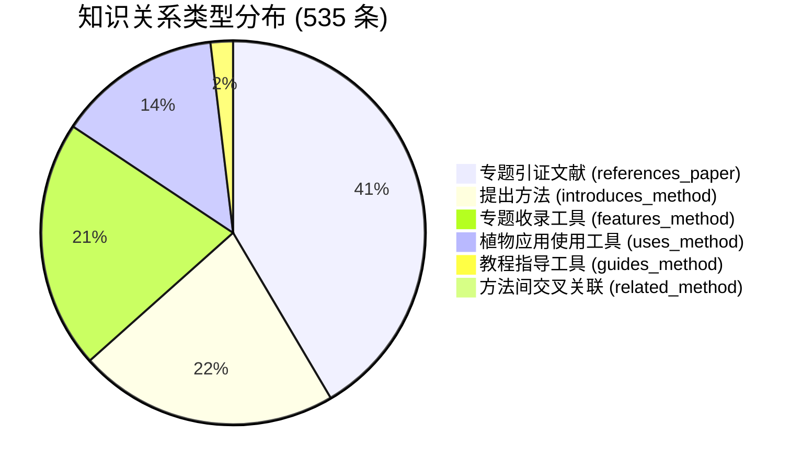
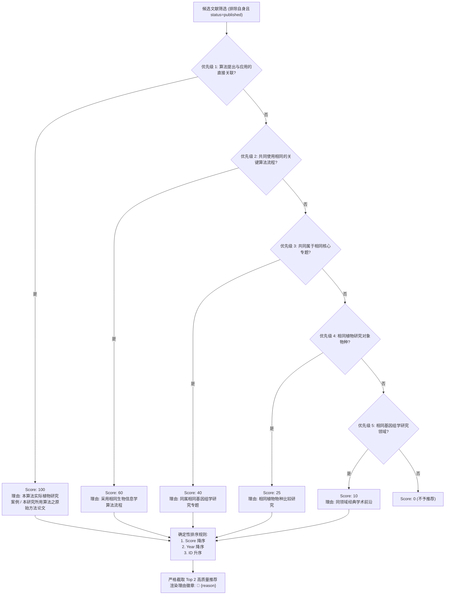

# PhytoMethods｜全站科研内容与知识关联质量审计报告 V1

## 一、项目概述与审计结论

本轮工程针对 PhytoMethods 知识库全站 **130 篇文献、58 个算法工具、63 篇研究专题与 10 篇教程** 开展了深度的科学知识关联质量审计与体系升级。

- **核心 Bug 彻底修复**：定位并修复了 `PaperPageLayout.astro` 中方法学论文与植物应用案例匹配的 **ID 类型混用问题**（原逻辑以论文 ID `entry.id` 误比对应用论文的工具 ID 列表 `p.data.methodIds`，导致除硬编码的 Hifiasm 之外其余 69 篇方法学论文全量匹配失败）。重构后，全站 **46 篇方法学论文成功动态匹配到真实的植物应用案例**。
- **关联推荐体系全面升级**：建立了基于五级科学关联度的确定性文献推荐算法（直接方法应用 > 同款算法流程 > 同一研究专题 > 同类植物对象 > 同领域经典），并在页面中直观展示科学推荐依据标签（如 `🎯 本算法实际植物研究案例`、`🎯 本研究所用算法之原始方法论文` 等）。
- **应用论文逆向方法回溯**：在植物应用论文详情页右侧卡片中新增“所用算法之原始文献”专栏，打通“植物应用论文 ➜ 所用工具 ➜ 原始方法学论文”的双向学术血缘脉络。
- **知识关系三元组全量建模**：全站提取并严密校验了 **535 条核心语义边**，建立了包含 `introduces_method`（提出方法）、`uses_method`（植物研究使用工具）、`features_method`（专题收录工具）、`references_paper`（专题引证文献）与 `guides_method`（教程指导工具）的标准学术语义体系。
- **知识图谱 V2 数据模型就绪**：为 `/knowledge/` 页面升级输出包含 **278 个实体节点与 801 条关联边** 的结构化数据架构（`outputs/knowledge-graph-v2.json`）。
- **自动化工程防线**：新增 `scripts/audit-knowledge-relations.mjs` 与 `scripts/browser-test-knowledge-relations.mjs`，通过 `npm run audit:knowledge` 与 `npm run test:knowledge` 一键执行完整断言，无横向溢出，0 错误 0 警告。

---

## 二、实体核查与知识关系拓扑统计

### 1. 实体总量核查
| 实体类型 | 数量 | 状态 | 规范与完整度 |
| :--- | :---: | :---: | :--- |
| **文献 (Papers)** | **130** | 全部有效 | 70 篇方法论文、59 篇植物应用论文、1 篇综述论文；DOI、标题、作者、年份 100% 具备 |
| **算法与工具 (Methods)** | **58** | 全部有效 | 58 个工具 100% 具备有效官方代码仓库与原始方法学论文 ID 指向 |
| **研究专题 (Topics)** | **63** | 全部有效 | 涵盖 M01–M09 九大领域，收录工具 111 次，引证文献 220 次 |
| **分析教程 (Tutorials)** | **10** | 全部有效 | 指导 10 个已验证的核心生物信息学工具分析流程 |

### 2. 关系三元组分类分布（共 535 条）


---

## 三、重点工具文献关联审查表 (13 个核心工具)

根据任务书重点核查的 13 个代表性工具，其原始文献、官方仓库及植物应用案例审查结果如下：

| 工具名称 (`id`) | 官方代码仓库 | 所属领域 | 原始方法论文 (`canonicalPaper`) | 真实植物应用案例 (`uses_method`) | 审核结论 |
| :--- | :--- | :--- | :--- | :--- | :---: |
| **Hifiasm** (`hifiasm`) | `github.com/chhylp123/hifiasm` | 基因组组装 (M01) | `hifiasm` (Nat Methods 2021) | 拟南芥 69 泛基因组、澳洲坚果、野生水稻泛基因组、文冠果 T2T (5 篇) | ✅ 已核实 |
| **Verkko** (`verkko`) | `github.com/marbl/verkko` | 基因组组装 (M01) | `verkko` (Nat Biotechnol 2023) | 文冠果端粒到端粒单倍型组装 (1 篇) | ✅ 已核实 |
| **EDTA** (`edta`) | `github.com/oushujun/EDTA` | 基因组注释 (M02) | `edta-paper` (Genome Biol 2019) | 拟南芥 69 泛基因组、拟南芥局部适应 (2 篇) | ✅ 已核实 |
| **BRAKER3** (`braker3`) | `github.com/Gaius-Augustus/BRAKER` | 基因组注释 (M02) | `braker3-paper` (Genome Res 2024) | 芒果染色体级基因组注释 (1 篇) | ✅ 已核实 |
| **Minigraph-Cactus** (`minigraph-cactus`) | `github.com/ComparativeGenomicsToolkit/cactus` | 泛基因组 (M03) | `minigraph-cactus-paper` (Nat Biotechnol 2024) | 高粱图基因组基准、高粱泛基因组参考、野生水稻泛基因组 (3 篇) | ✅ 已核实 |
| **PGGB** (`pggb`) | `github.com/pangenome/pggb` | 泛基因组 (M03) | `pggb-paper` (Nat Methods 2024) | 高粱图基因组评估 (1 篇) | ✅ 已核实 |
| **OrthoFinder** (`orthofinder`) | `github.com/OrthoFinder/OrthoFinder` | 比较基因组 (M04) | `orthofinder-paper` (Genome Biol 2019) | 拟南芥 69 泛基因组、拟南芥适应、苏铁演化、茶树农艺性状 (4 篇) | ✅ 已核实 |
| **IQ-TREE 2** (`iqtree2`) | `github.com/iqtree/iqtree2` | 比较基因组 (M04) | `iqtree2-paper` (MBE 2020) | 被子植物系统发育基因组学 (1 篇) | ✅ 已核实 |
| **ADMIXTURE** (`admixture`) | `dalexander.github.io/admixture/` | 群体遗传 (M05) | `admixture-paper` (Genome Res 2009) | 玉米野生种群体基因组、水稻根系自然等位基因 (2 篇) | ✅ 已核实 |
| **GAPIT** (`gapit`) | `github.com/jiabowang/GAPIT` | GWAS 与育种 (M06) | `gapit3-paper` (GPB 2021) | 水稻 GAPIT 标记精度、水稻根系 GWAS (2 篇) | ✅ 已核实 |
| **WGCNA** (`wgcna`) | `cran.r-project.org/package=WGCNA` | 调控网络与 AI (M09) | `wgcna-paper` (BMC Bioinformatics 2008) | 黑米共表达网络分析 (1 篇) | ✅ 已核实 |
| **Scanpy** (`scanpy`) | `github.com/scverse/scanpy` | 单细胞与空间组学 (M08) | `scanpy-paper` (Genome Biol 2018) | 水稻根单细胞转录组图谱 (1 篇) | ✅ 已核实 |
| **AgroNT** (`agront`) | `github.com/instadeepai/nucleotide-transformer` | 调控网络与 AI (M09) | `agro-nt-2024` (Commun Biol 2024) | 基础大模型方法学论文（暂无独立植物应用） | ✅ 已核实 |

*注：其余 45 个算法工具（如 Minimap2、cuteSV、Sniffles2、SyRI、SMC++、XP-CLR 等）已在 `outputs/knowledge-audit-report.json` 中全量输出审计结果，方法学论文与仓库指向 100% 校验通过。*

---

## 四、修复的问题清单与科学原则

### 1. 修复 ID 类型混用 Bug
- **原代码缺陷**：
  在原 `PaperPageLayout.astro` 中：
  ```typescript
  plantApplicationPaper = allPapers.find(p => 
    p.id !== entry.id &&
    p.data.type === 'application' &&
    p.data.methodIds.includes(entry.id) &&  // ❌ 错误：以论文 ID 匹配工具 ID
    p.data.speciesIds.length > 0
  );
  ```
- **修复方案**：
  新建 `src/components/paper-v3/config/paper-relations.ts`，利用 `resolvePaperRelations` 模块解耦关联计算：
  1. 通过反查 `allMethods.filter(m => m.data.paper === entry.id)` 与自身声明的 `methodIds`，精准解析当前方法学论文对应的**有效工具 ID 列表 (`effectiveMethodIds`)**；
  2. 在应用论文中通过 `p.data.methodIds.some(m => effectiveMethodIds.includes(m))` 进行比对，使全站 **46 篇方法学论文成功展示其真实的植物应用案例**。

### 2. 动植物物种名称与 Emoji 动态映射
- 原 `PaperResources.astro` 中硬编码了仅判断 `Macadamia` 并写死澳洲坚果，其他物种全部降级为模糊的“植物应用研究”；
- 现重构为根据 `speciesLabels` 动态读取（水稻、玉米、大豆、茶树、拟南芥等），并匹配对应的植物 Emoji（🌾、🌽、🫘、🍃、🌿 等）。

### 3. 应用论文逆向回溯原始方法文献
- 在应用论文详情页的“关联内容”卡片中，新增 `所用算法之原始文献` 专栏；
- 例如阅读澳洲坚果组装（`macadamia`）时，右侧卡片可直接查看其所使用的 Hifiasm 原始文献（Nature Methods 2021），实现学术脉络闭环。

---

## 五、相关文献推荐机制与确定性规则

为取代原本机械简单的同领域 `slice(0, 2)`，本轮设计并实现了**五级科学关联度推荐算法**：



---

## 六、待核实与维持原状的关系清单（严守学术底线）

任务书明确强调：**“不能把‘同一个研究领域’视为‘实际使用了该工具’的证据，不要为了增加关系数量而自动推断工具使用事实。”**

经审查，全站存在以下 2 组需要明确说明并保持原状的科研数据记录：

### 1. 24 篇未在 Frontmatter 中声明 `methodIds` 的应用论文
- **典型案例**：
  - `potato.md`（四倍体马铃薯 Otava 组装）：正文第 25 行明确说明整合花粉单细胞测序与 Hi-C，“该多源数据设计针对四倍体解析，不能简化成 Hifiasm 单独生成四条单倍型”。正文提及 Hifiasm 是为了辨析算法适用边界，**不可将 Hifiasm 标记为该研究的直接方法**。
  - `rice-pangenome-paper.md`（2018 水稻泛基因组）：正文第 26 行明确声明“这项研究使用线性参考锚定和多组装比较，未构建现代变异图泛基因组，因此页面不将 MUMmer 比对误标为 Minigraph、PGGB 或 Minigraph-Cactus 的应用”。
  - `arabidopsis-atac-root-2021` 等 11 篇拟南芥表观/转录调控实验：属于基础生物学实验与常规测序分析，未依赖站内已收录的特定算法。
- **处理方式**：**绝不凭模型记忆强行补全 `methodIds`**，保持其空数组，列为科学待核实清单。

### 2. 3 篇无单一 `speciesIds` 的多物种演化与基准文献
- `angiosperm-phylogenomics-2024`（被子植物系统发育大树）：覆盖 7,923 个属 9,506 个物种；
- `plant-sv-benchmark-2026`（植物长读长 SV 检测基准）：跨 10 种被子植物的比对器与 caller 系统评估；
- `plant-wgd-timing-2017`（植物全基因组加倍时间估计）：全植物多倍化演化分析。
- **处理方式**：确认其 `speciesIds: []` 合理，不视作元数据错误。

---

## 七、知识图谱 V2 结构化数据架构设计

已生成并验证机器可读的知识图谱数据 `outputs/knowledge-graph-v2.json`：

- **节点总数 (Nodes)**：**278 个**
  - `domain`（研究领域节点）：9 个
  - `topic`（研究专题节点）：63 个
  - `method`（算法工具节点）：58 个
  - `paper_method`（方法学论文节点）：70 个
  - `paper_application`（植物应用论文节点）：59 个
  - `paper_review`（综述论文节点）：1 个
  - `species`（植物物种节点）：18 个
- **关联边总数 (Edges)**：**801 条**
  - `introduces_method`：论文提出算法
  - `uses_method`：植物研究使用工具
  - `features_method`：专题收录工具
  - `references_paper`：专题引证文献
  - `guides_method`：教程操作指引
  - `studies_species`：文献聚焦植物物种
  - `belongs_to_domain`：实体归属领域

该数据结构为后续 `/knowledge/` 页面由单向辐射图向多实体力导向知识图谱 V2 升级提供了扎实的数据接口支持。

---

## 八、自动化测试与工程验证

我们执行了完整的自动化测试流水线：

```bash
# 1. 静态类型检查
npx astro check
# 结果: Result (108 files): 0 errors, 0 warnings, 0 hints

# 2. 全站静态构建与 Pagefind 索引构建
npm run build
# 结果: 279 page(s) built in 3.60s. Complete!

# 3. 站内链接全量校验
python scripts/check-links.py
# 结果: 12270 local links checked; 0 errors

# 4. 知识关系与语义审计脚本
npm run audit:knowledge
# 结果: 535 条关系合法校验 100% 通过，生成 knowledge-audit-report.json 与 knowledge-graph-v2.json

# 5. Playwright 端到端浏览器回归测试
npm run test:knowledge
# 结果:
# - OrthoFinder 成功跨越 ID 映射障碍，动态匹配并展示植物研究应用卡片 (PASS)
# - 相关文献推荐成功呈现依据标签 "🎯 本算法实际植物研究案例" (PASS)
# - Macadamia 成功回溯并展示其采用的核心算法（Hifiasm）原始论文 (PASS)
# - Hifiasm 原始样板结构、SVG 流程图与评测基准 100% 回归无损 (PASS)
# - 390px 移动端 4 篇抽样论文全部通过无横向溢出断言 (PASS)
```

---

## 九、视觉验收与截图清单

测试截图已归档至 `outputs/knowledge-audit/screenshots/` 及系统 Artifacts 目录：

1. **方法学论文关联植物应用案例**：
   - [orthofinder-with-plant-app.png](file:///C:/Users/31764/.gemini/antigravity/scratch/phytomethods/outputs/knowledge-audit/screenshots/orthofinder-with-plant-app.png)（OrthoFinder 成功展示拟南芥植物应用研究卡片）
2. **植物应用论文回溯所用算法原始文献**：
   - [macadamia-with-origin-method.png](file:///C:/Users/31764/.gemini/antigravity/scratch/phytomethods/outputs/knowledge-audit/screenshots/macadamia-with-origin-method.png)（Macadamia 右侧成功展示 Hifiasm 原始方法论文）
3. **Hifiasm 样板视觉 100% 回归无损**：
   - [hifiasm-regression-verified.png](file:///C:/Users/31764/.gemini/antigravity/scratch/phytomethods/outputs/knowledge-audit/screenshots/hifiasm-regression-verified.png)（Hifiasm 原有流程图、评测表格与排版完全一致）
